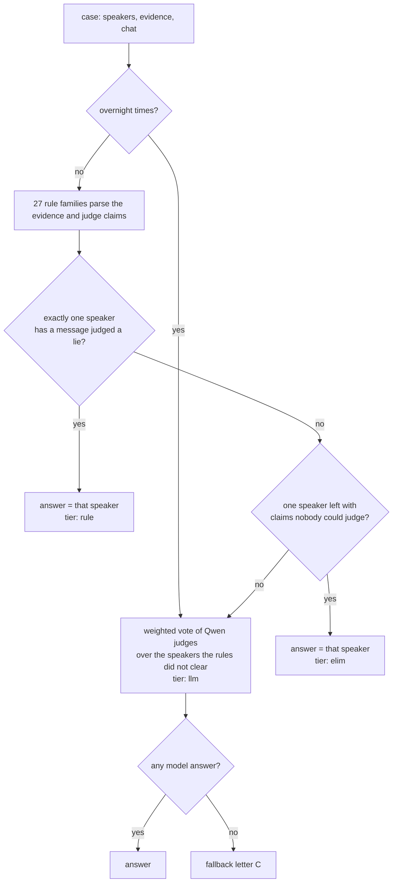

<div align="center">

# The Liar's Chatroom

**A rule solver that answers what it can prove, and open-weight language models that vote on the rest.**<br>
Pure-Python rules, then thinking-mode Qwen judges served with vLLM, combined by one small script.

[](#environment)
[](#environment)
[](#rules-compliance)
<br>
[](#scorecard)
[](#how-we-tested)
[](#how-we-tested)

</div>

Team Claude Laggye's entry for the Kaggle competition The Liar's Chatroom (Synergy '26, IIIT Bangalore). This file is the methodology document for code verification. It says what each step does, which model and revision each vote comes from, and which commands rebuild the uploaded file. Every number below comes from a command or file named next to it. The numbers that change while more model runs finish are collected in one table, [Results](#results).

## Contents

- [The task](#the-task)
- [Scorecard](#scorecard)
- [How it works](#how-it-works)
- [Rules compliance](#rules-compliance)
- [Models used](#models-used)
- [Reproduce](#reproduce)
- [How we tested](#how-we-tested)
- [Results](#results)
- [Limitations](#limitations)
- [Repository layout](#repository-layout)
- [Licences, credits and citations](#licences-credits-and-citations)
- [Team](#team)

## The task

Each case is a short group chat between four speakers, A to D, plus a paragraph of verified evidence. Exactly one speaker sent a message that cannot be true together with the evidence. The model must name that speaker. The metric is accuracy. `train.csv` has 2,500 labelled cases, `test.csv` has 3,500 unlabelled cases, and the public leaderboard scores about 900 of them (its scores move in steps of 1/900). The other test cases form the private slice.

The official rules, in brief:

- Only the evidence and the speaker table are true. A claim contradicts the evidence only if both cannot be true at once, judged by literal meaning, logic, and clock and calendar arithmetic. Unverified, suspicious or unlikely is not a contradiction.
- A person or object cannot be in two places at once when the evidence says the places are separate. Records and lists are complete only if the evidence says so. "Between 8:00 AM and 9:00 AM" includes both ends, and "after noon" excludes noon.
- Questions and opinions are never the answer. Tone, length and position do not mark the liar.
- The answer is the sender of the contradicting message, even when that message is about someone else.
- Test contains scenario families that train does not. The sponsor may re-run the frozen code of top teams on further hidden cases, including families in neither file.
- No closed or hosted model APIs. Open-weight models up to 70B parameters are allowed if free for everyone, and every pretrained model must be named. No hand labelling of test, and no designing rules by reading `test.csv`.

## Scorecard

Public leaderboard uploads, from `submissions/LOG.md`:

| Upload | What it contains | md5 of the file | Commit | Public leaderboard |
|---|---|---|---|---|
| `s1_rules_only.csv` | Rule solver alone. Cases the rules do not answer get the letter C. A check of rule precision on test, not a real attempt. | `96e2b8fd4448dde7caa94a58207d4178` | `64fa2f1` | 0.93333 |
| `s2_rules_4b_8b.csv` | Rules (final four families) plus the vote of Qwen3.5-4B on all 1,066 hard cases and Qwen3-8B on part of them, restricted to the speakers the rules did not clear. | `32d33d2a8a1485ba12955a459e4e09b4` | `f6b52de` | 1.00000 |

Train metrics, all from commands in this repository:

| Measure | Value | Command |
|---|---|---|
| Rule solver, cases answered | 2,257 of 2,500 (90.3%) | `python -m lc.rules.run` |
| Rule solver, precision on answered cases | 100.00% (2,257 of 2,257) | same |
| Liars wrongly judged consistent by the rules | 0 | same |
| Innocent speakers judged liars, any family | 0 | same |
| Qwen3-8B-AWQ on `dev200` | 191 of 200 (95.5%) | `python -m lc.llm.eval` |
| Qwen3-14B-AWQ on `dev200` (Kaggle) | 194 of 200 (97.0%) | same |
| Qwen3.5-4B-AWQ on 135 of the 244 hard train cases | 135 of 135 | same |
| All three models on the 20 `dev200` cases the rules cannot answer | 20 of 20 each (4B: 9 of 9 that it ran) | scored from the output files |

`dev200` is 200 train cases drawn with a fixed seed. "Hard" means a train case the rules cannot answer: 244 cases listed in `docs/ids/train_hard.txt`. The three models' mistakes on `dev200` (9, 6 and none for 8B, 14B and 4B) are all on cases the rules already answer correctly, so they never reach the vote in the final pipeline.

## How it works



### The rule solver

`lc/rules/core.py` defines a `Family` interface. A family recognises one kind of evidence, such as "nobody entered the vault between 9:00 AM and 11:00 AM" or "a tank holds 400 litres and is drained at a steady rate". It has two methods. `parse(ctx)` returns the facts if its evidence is in the case, and tells the solver which evidence sentences it understood. `judge(ctx, facts, msg)` returns a verdict of `lie` or `ok` for a message it fully understands, and nothing otherwise. A `lie` verdict is allowed only when the claim cannot be true together with the evidence. The solver collects the verdicts, and a case is answered when exactly one speaker has a message judged a lie.

There are 27 families in four modules: `fam_access.py` (9 families: windows, supplies, door codes, lists, badges, logs, arrivals, presence, bookings), `fam_calendar.py` (6: opening hours, closed days, rotas, sessions, ages, owners), `fam_movement.py` (8: routes, vehicles away, travel between places, rooms, objects, seals, hand-overs, counts) and `fam_quantity.py` (4: container levels, ticket sales, cut pieces, attendance lists). Shared parsing for clock times, dates, durations and sentences is in `lc/rules/text.py`.

The design puts precision before coverage:

- **Whole-sentence matching.** An evidence pattern must match a complete sentence, every clause. A sentence with a clause the family does not model (an exception, a second schedule, a condition) is left unread.
- **Abstain near unread evidence.** When an unread sentence names the same person, place, object or duty as a parsed fact, the family drops that fact and says nothing, because the unread sentence might change what the fact means.
- **Plain claims only.** Questions, hedged or negated sentences, reported speech and claims at the exact edge of a window are not judged. They stay with the model judges.
- **Exact arithmetic.** Quantities use Python `fractions.Fraction`, never floats. Times are whole minutes in one day.
- **The overnight guard.** `overnight()` in `core.py` makes the rules step aside for any case that mentions midnight or a clock time before 5:00 AM. The families compare minutes within one day, so a window that crosses midnight would be misread. Train has no such case.
- **Fillers.** `is_filler()` treats a question, or a sentence with no digit that reads as an opinion, as never the answer.

An exception inside a family never stops a case. It is recorded and the family is skipped. On train there are none.

### The model judges

`lc/llm/prompt.py` builds one prompt per case: the official rules in a short list, the scenario, the speaker table, the evidence, the numbered chat, and the instruction to check every claim against the evidence and end with a line `ANSWER: <letter>`. The same prompt goes to every model.

`lc/llm/judge_vllm.py` runs a model over a list of case ids with vLLM:

- **Thinking mode.** The chat template is applied with `enable_thinking=True`, so the model reasons inside `<think>` before the answer. Sampling is temperature 0.6, top-p 0.95, top-k 20, one sample per case, seed 0. The 4B model also uses presence penalty 1.5.
- **Length cap.** Output is capped at `--max-tokens` (default 8192, thinking included).
- **Forced answers.** If a sample ends without an `ANSWER:` line, usually because it hit the cap, the script appends `</think>` (if the thought never closed) and `ANSWER:` to the prompt and takes one greedy token. The record marks that answer as forced.
- **Letter probabilities.** At the answer token the script reads the 20 most likely tokens and sums the probability of each letter (" B", "B" and "**B" all count as B). These probabilities go into the output as `p_mean`.
- **Output.** One JSON line per case, flushed at once, with `pred`, `p_mean`, token counts and the forced flag. A killed run resumes and skips finished ids.

### The combination

`lc/combine.py` decides each case in this order:

1. **rule.** Exactly one speaker has a message judged a lie, so that speaker is the answer.
2. **elim.** No rule fired, but every claim of three speakers was judged consistent and the fourth has claims nobody could judge. One liar exists, so it is the fourth. On train this tier never fires. On test it fires for 8 cases.
3. **llm.** A weighted vote of the model files over the speakers the rules did not clear. A speaker is cleared when all of their non-filler claims were judged consistent. Each model's letter probabilities are renormalised over the remaining speakers, multiplied by the file's weight, and summed. A forced answer counts at half weight. A model whose probability mass sits entirely on cleared speakers abstains. Ties go to the highest-weight model that voted.
4. **fallback.** The letter C, the most common train label, only if no model answered.

Weights are given per file as `--llm path@weight` (default 1).

## Rules compliance

Competition rule numbers refer to section 10 of the Rules tab.

| Rule | What this entry does |
|---|---|
| 10a. No closed or hosted model APIs at any step | No network call to a model service exists in the code. Every model runs locally from downloaded weights, through vLLM. `lc/` imports only the standard library and vLLM. |
| 10b. Open-weight models up to 70B, licence allows use, named | Five models, all Apache-2.0, the largest 32B. Named with repository and revision in [Models used](#models-used). |
| 10c. Public external data and compliant synthetic data only | No external data and no synthetic data. Nothing is trained or fine-tuned. The models are used as released. |
| 10d. No hand labelling of test | No test label was typed, read or chosen by a person. Test labels come only from the rule solver and the model votes. |
| 10e. No test-specific design | Rule families were written from train cases and scored on train only (`lc/rules/run.py` refuses any other split). Test inputs go through the same code as train. Checks on test are counts, such as how many cases the rules answer, and no test row was read or printed. No logic is keyed to a test id. |
| 10f. Reproducible from code | The rules, prompt, runner, combiner and submission check are in this repository, with pinned model revisions and package versions. See [Reproduce](#reproduce). |
| 10g. Pseudo-labelling only if automatic | None is used. Model votes are never fed back into the rules or the prompt. |

## Models used

All weights come from Hugging Face at the exact revision shown, and are downloaded by `scripts/server/get_models.sh` or by the Kaggle launcher. Sizes are the on-disk size of the quantised checkpoint.

| Model | Revision | Licence | Size | Used for |
|---|---|---|---|---|
| [`cyankiwi/Qwen3.5-4B-AWQ-4bit`](https://huggingface.co/cyankiwi/Qwen3.5-4B-AWQ-4bit), 4-bit quantisation of `Qwen/Qwen3.5-4B` | `d3e78b50c727b1f34802f440ca84b25781625352` | Apache-2.0 | 4.1 GB | GPU server. Test, first 1,066 ids. Train, hard cases. |
| [`Qwen/Qwen3-8B-AWQ`](https://huggingface.co/Qwen/Qwen3-8B-AWQ) | `4da05a8edb55c6046cce958586c33b61da07bb79` | Apache-2.0 | 6.1 GB | GPU server. `dev200`, test first 1,066 ids. |
| [`Qwen/Qwen3-14B-AWQ`](https://huggingface.co/Qwen/Qwen3-14B-AWQ) | `31c69efc29464b6bb0aee1398b5a7b50a99340c3` | Apache-2.0 | 10.0 GB | Kaggle, two T4 cards. `dev200`, then all test ids. |
| [`Qwen/Qwen3-32B-AWQ`](https://huggingface.co/Qwen/Qwen3-32B-AWQ) | `0499c3ac83fdef8810b907a23894ba91e95eddd8` | Apache-2.0 | 19.3 GB | Kaggle. Test ids 1,752 to 3,500. |
| [`Qwen/QwQ-32B-AWQ`](https://huggingface.co/Qwen/QwQ-32B-AWQ) | `dc9f21221581580ccfa51b74077db6056b56cb69` | Apache-2.0 | 19.3 GB | Kaggle. 60 train cases, then test ids 534 to 1,066. |

The check model `Qwen/Qwen3.5-0.8B` (revision `2fc06364715b967f1860aea9cf38778875588b17`) is used only by `scripts/server/smoke_test.sh` to confirm that vLLM runs on the server. It votes on nothing. The same list with notes is in `docs/models.md`.

The Kaggle runs are built by `kaggle/build.py` on the `kaggle-tools` branch. It embeds the committed `lc` files, the id lists and a launcher into one `run.py` per notebook, and records the `lc` commit in its first line. The build refuses to run if the embedded `lc` files have uncommitted changes.

## Reproduce

### Environment

- **GPU server.** One NVIDIA RTX A6000 shared with other users, with about 10 GB free for these jobs, driver 570 (CUDA 12.8), Python 3.12. `scripts/server/setup_env.sh` builds the environment: vLLM 0.32.0 (the CUDA 12.9 wheel from its GitHub release), PyTorch 2.13.0+cu129, Transformers 5.19.0, compressed-tensors 0.17.0, huggingface_hub 2.4.0. The PyPI vLLM wheels need CUDA 13, so this wheel is the one that works with driver 570. The script ends with a smoke test and writes `requirements.lock.txt`.
- **Kaggle notebooks.** Two T4 cards (tensor parallel size 2, float16), internet on, built by `kaggle/build.py`. The launcher installs the same vLLM wheel into a fresh Python 3.12 environment, downloads the model at its pinned revision, and runs `kjudge.py`, which is `judge_vllm.py` with the same prompt, sampling and answer parsing on two cards.
- **Rules and combiner.** Standard library only, Python 3.12.

Set `LC_DATA_DIR` to the folder holding `train.csv`, `test.csv` and `sample_submission.csv`. The data files are not committed.

### Steps

1. Rule solver on train. About 10 s on a laptop CPU.

   ```
   LC_DATA_DIR=<data> python -m lc.rules.run
   ```

   It prints cases answered, precision, wrongly cleared liars and per-family counts. Rules on test run inside step 5, because `lc.rules.run` is train-only by design.

2. Server setup and downloads, once.

   ```
   bash scripts/server/setup_env.sh
   bash scripts/server/get_models.sh
   ```

3. Judge runs on the GPU server, from the repository folder. The id lists are in `docs/ids/`. `test_llm_order.txt` holds all 3,500 test ids with the cases the rules could not answer first, and the runs below use its first 1,066 lines. The 4B and 8B runs for the combination:

   ```
   export LC_DATA_DIR=<data>
   head -n 1066 docs/ids/test_llm_order.txt > first1066.txt
   python -m lc.llm.judge_vllm --model models/qwen35-4b-awq --split test --ids first1066.txt \
       --out outputs/test_qwen35-4b_n1.jsonl --presence-penalty 1.5
   python -m lc.llm.judge_vllm --model models/qwen3-8b-awq --split test --ids first1066.txt \
       --out outputs/test_qwen3-8b_n1.jsonl
   ```

   Train checks use the same command with `--ids configs/dev200.txt` (8B and 14B) or `--ids docs/ids/train_hard.txt` (4B), and then `python -m lc.llm.eval <out> --ids <ids>` to score them. `configs/dev200.txt` can be rebuilt with `python -m lc.llm.dev_ids --k 200 --seed 13`.

4. Judge runs on Kaggle. Each folder is one notebook; all but the first are on the `kaggle-tools` branch. Push it with the Kaggle command line tool (`kaggle kernels push -p kaggle/<folder>`) after filling in the owner in `kernel-metadata.json`. Each embeds the id lines shown, counted in `docs/ids/test_llm_order.txt`:

   | Folder | Model | Test id lines | Output file |
   |---|---|---|---|
   | `judge14b` (built the same way, kept outside that branch) | Qwen3-14B-AWQ | 1 to 1,003, after the 200 `dev200` cases | `test_qwen3-14b-awq_kaggle.jsonl` |
   | `judge14b-1004-2250` | Qwen3-14B-AWQ | 1,004 to 2,250 | `test_qwen3-14b_1004-2250.jsonl` |
   | `judge14b-2251-3500` | Qwen3-14B-AWQ | 2,251 to 3,500 | `test_qwen3-14b_2251-3500.jsonl` |
   | `judge14b-retry` | Qwen3-14B-AWQ, 16,384-token cap | the 29 forced cases of the first file | `test_qwen3-14b_retry16k_nirbhay.jsonl` |
   | `judge32b-1752-2436` | Qwen3-32B-AWQ | 1,752 to 2,436 | `test_qwen3-32b_1752-2436.jsonl` |
   | `judge32b-t2` | Qwen3-32B-AWQ | 2,437 to 3,500 | `test_qwen3-32b_t2_nirbhay.jsonl` |
   | `judgeqwq-534-1066` | QwQ-32B-AWQ | 534 to 1,066, after 60 train cases | `test_qwq-32b_534-1066.jsonl` |

   The 14B notebooks use `--max-num-seqs 40 --max-tokens 8192` (the first 14B notebook used 32 sequences and the default 6,000-token cap), the 32B notebooks use `--max-num-seqs 12 --max-num-batched-tokens 2048 --gpu-util 0.93 --max-tokens 8192`, and QwQ adds `--top-k 40`. A notebook stops waiting for new cases after 11.5 hours.

5. Combine and write the submission. Give each model file its weight with `@`. The call below is the shape of the final command, with the files that exist today. The files from the notebooks above are added the same way, with their weights.

   ```
   python -m lc.combine --split test \
       --llm outputs/test_qwen35-4b_n1.jsonl \
       --llm outputs/test_qwen3-8b_n1.jsonl \
       --llm outputs/test_qwen3-14b-awq_kaggle.jsonl@1.5 \
       --out submissions/sub.csv
   ```

   The same command with `--split train` and the `dev200` and hard-case files scores the combination on train.

6. Check and log the file.

   ```
   python -m lc.submit submissions/sub.csv --note "rules + model votes"
   ```

   It checks the header `id,label`, that the ids match `sample_submission.csv` once each, and that every label is A, B, C or D. It prints the md5 and appends a row to `submissions/LOG.md`.

### Time per step

| Step | Time | Source |
|---|---|---|
| Rules on all 2,500 train cases (`lc.rules.run`) | 9.8 s | measured on this laptop |
| Rules and combiner on all 3,500 test cases (`lc.combine`) | 10.2 s | measured on this laptop |
| Kaggle notebook start-up (package install, model download) | about 2.3 min for the 14B model, 3.1 min for 32B | Kaggle session logs |
| Qwen3-14B-AWQ on two T4 cards | about 8.4 cases per minute, 1,100 to 1,300 output tokens per case on `dev200` | Kaggle session log of the 200-case phase |
| Qwen3-32B-AWQ on two T4 cards | 3.7 cases per minute, 60 train cases in 16.0 min | Kaggle session log |
| Qwen3.5-4B and Qwen3-8B on the server | not timed in the logs kept with this repository | the output files hold mean output tokens per case, in [Results](#results) |

### What to compare

The upload `s2_rules_4b_8b.csv` has md5 `32d33d2a8a1485ba12955a459e4e09b4`. It cannot be rebuilt from the output files as they stand today. When it was made, the Qwen3-8B file held only part of its cases, and that file has since grown to 469. Running step 5 with the 4B and 8B files as they are now gives a file that differs from the upload in 23 of 3,500 labels. Every upload is logged with its md5 and commit in `submissions/LOG.md`, and the final upload's row names the exact files and weights. Rerunning `lc.combine` on the same model files, at the same commit, always gives the same file, because the combiner has no random step. Rerunning a judge can change a few answers, because batched GPU inference is not bit-exact between runs.

## How we tested

- **Rule solver on train.** `python -m lc.rules.run` scores the rules on all 2,500 train cases. It reports cases answered (2,257), precision on those (100%), how often a family judged an innocent speaker a liar (0 in every family), and the number of cases where every claim of the true liar was judged consistent (0). That last number must be zero, since a wrongly cleared liar would be removed from the vote and could never be found. Every rule change was held to these three numbers.
- **`dev200`.** 200 train cases drawn with a fixed seed (13), stratified by the true sender and the number of messages (`lc/llm/dev_ids.py`). It scores each judge on a mix of easy and hard cases. 180 of the 200 are answered by the rules and 20 are not.
- **Hard train cases.** The 244 train cases the rules could not answer when the list was made (243 today) are the cases where the model vote decides. Qwen3.5-4B was scored on 135 of them.
- **Per-model scoring.** `python -m lc.llm.eval` gives accuracy, a confusion table, accuracy by number of messages and by evidence type, the number of forced answers, and output tokens per case.
- **Agreement between models on test, as an uncertainty signal.** The check uses counts only. Over the test cases two models both answered, Qwen3.5-4B and Qwen3-8B give the same letter on 429 of 469, Qwen3.5-4B and Qwen3-14B on 980 of 1,003, and Qwen3-8B and Qwen3-14B on 422 of 448. All three agree on 408 of the 448 cases that all three answered. Disagreement is read as a sign that a case is uncertain. It does not change any answer.
- **Public leaderboard.** Used as a check of the finished pipeline, never to tune. Two uploads, listed in the [Scorecard](#scorecard).

## Results

This is the table to update as runs finish. Counts for model files come from the files in `outputs/`.

| Item | Value now | Where it comes from |
|---|---|---|
| Public leaderboard, rules only | 0.93333 | `submissions/LOG.md` |
| Public leaderboard, rules and model vote | 1.00000 | `submissions/LOG.md` |
| Rule solver on test, cases answered | 2,428 of 3,500 (69.4%), of which 1,070 had every claim judged | `python -m lc.combine --split test` |
| Rule solver on test, earlier version used in the first upload | 2,486 of 3,500 | commit `64fa2f1`, same count |
| Elimination answers on test | 8 | same |
| Test cases left to the model vote | 1,064 (466 with two model votes, 598 with one) | same, with the 4B and 8B files |
| Qwen3.5-4B test file | 1,066 cases, 190 forced answers (17.8%), mean 6,006 output tokens | `outputs/test_qwen35-4b_n1.jsonl` |
| Qwen3-8B test file | 469 cases, 32 forced answers (6.8%), mean 3,332 output tokens | `outputs/test_qwen3-8b_n1.jsonl` |
| Qwen3-14B-AWQ test file (ids 1 to 1,003) | 1,003 cases, 29 forced answers (2.9%), mean 1,568 output tokens | `outputs/test_qwen3-14b-awq_kaggle.jsonl` |
| Qwen3-8B on `dev200` | 191 of 200, 5 forced answers, mean 2,416 output tokens | `python -m lc.llm.eval` |
| Qwen3-14B-AWQ on `dev200` | 194 of 200, 7 forced answers, mean 1,392 output tokens | same |
| Qwen3.5-4B on 135 hard train cases | 135 of 135, no forced answers, mean 5,436 output tokens | same |
| Qwen3-32B-AWQ on 60 train cases | 58 of 60, 1 forced answer | Kaggle session log; the output file is not in `outputs/` |
| Combination on train, rules plus the files above | 146 of 146 cases that reach the vote are right | `python -m lc.combine --split train --llm ...` |
| Still to come, 14B | test ids 1,004 to 3,500 and the 16,384-token retry | notebooks `judge14b-1004-2250`, `judge14b-2251-3500`, `judge14b-retry` |
| Still to come, 32B and QwQ | 32B on ids 1,752 to 3,500, QwQ-32B on ids 534 to 1,066 | notebooks `judge32b-1752-2436`, `judge32b-t2`, `judgeqwq-534-1066` |

The last train row counts train cases the rules do not answer and at least one model file covers (146 of the 243). The other 97 have no model file yet, so the full train accuracy of the combination is not a number we can state today.

On the first upload, the public slice scored 0.93333 with C filled in for every unanswered case. If the rules were fully precise there, that score means they answered about 91% of the public slice. They answer 69% of all test cases, so coverage on the rest is lower, and the public score is a flattering view of the private slice.

## Limitations

- **New families.** The private slice, and the sponsor's re-run on hidden cases, include scenario families that train does not have. The rules cover 90.3% of train and 69.4% of test, and they are written from train. On a new family they will mostly abstain, as designed, and the models decide. Model accuracy on a family nobody has seen is untested.
- **Rule coverage is not accuracy on test.** The rules score 100% on train because they were built against it. Their precision on test is checked only through the public leaderboard.
- **Length caps.** Thinking is capped at 8,192 tokens (6,000 for the first 14B notebook). The smaller the model, the more often it hits the cap: 17.8% of Qwen3.5-4B test cases end in a forced answer, against 2.9% for Qwen3-14B. A forced answer is a weaker vote, so it counts at half weight.
- **GPU memory.** The server has about 10 GB free, which limits it to the 4B and 8B models. The 14B, 32B and QwQ models run on Kaggle's two T4 cards, whose memory is tight with the 32B models, so those run 10 to 12 cases at a time.
- **Not bit-exact.** vLLM batching can change near-ties between two runs of the same judge. The combiner is deterministic, the judges are not.
- **Weights are not tuned.** The `@weight` of each model file is set by hand, and `dev200` and the hard cases are too small a sample to tune them. The final upload's row in `submissions/LOG.md` records the weights used.
- **Unseen wordings.** No test row was read, so a wording that appears only in test is handled only if a family's whole-sentence patterns happen to match it.

## Repository layout

```
lc/
  data.py            read the CSVs into Case objects (LC_DATA_DIR)
  rules/
    core.py          Family interface, solver, overnight guard
    text.py          clock times, dates, durations, sentence splitting, fillers
    fam_access.py    9 families: who could enter, use or be somewhere, and when
    fam_calendar.py  6 families: opening hours, closed days, rotas, sessions, ages, owners
    fam_movement.py  8 families: routes, travel, rooms, objects, seals, hand-overs, counts
    fam_quantity.py  4 families: container levels, tickets, cut pieces, attendance
    run.py           score the rules on train
  llm/
    prompt.py        the judge prompt
    judge_vllm.py    batched vLLM runner, forced answers, letter probabilities
    eval.py          score a judge's output on train
    dev_ids.py       draw dev200
  combine.py         rule, elimination, weighted vote, submission file
  submit.py          check a submission file and log its md5
configs/dev200.txt   the 200 development ids
docs/models.md       models and libraries with revisions and licences
docs/ids/            test_llm_order.txt (all test ids, rule-unanswered first), train_hard.txt (244 ids)
scripts/server/      setup_env.sh, get_models.sh, smoke_test.sh and .py
```

On the `kaggle-tools` branch: `kaggle/build.py`, `kaggle/kjudge.py`, `kaggle/launcher.py` and one folder per notebook.

Where our code is:

| Question | File |
|---|---|
| What does a rule family look like? | `lc/rules/core.py` |
| Why does the rule solver ever stay silent? | `lc/rules/core.py` (`overnight`, `Ctx.consume`) and the module docstrings of the four `fam_*.py` files |
| What prompt do the models get? | `lc/llm/prompt.py` |
| How is a forced answer made? | `lc/llm/judge_vllm.py` (`read_answer` and the `#force` requests) |
| How are the votes combined? | `lc/combine.py` (`decide`, `vote`) |
| How is a file checked before upload? | `lc/submit.py` |

## Licences, credits and citations

| Component | Use | Licence |
|---|---|---|
| [Qwen3-8B-AWQ, Qwen3-14B-AWQ, Qwen3-32B-AWQ, QwQ-32B-AWQ](https://huggingface.co/Qwen) by the Qwen team, Alibaba Cloud | judges | Apache-2.0 |
| [Qwen3.5-4B](https://huggingface.co/Qwen/Qwen3.5-4B), 4-bit quantisation by [cyankiwi](https://huggingface.co/cyankiwi/Qwen3.5-4B-AWQ-4bit) | judge | Apache-2.0 |
| [vLLM](https://github.com/vllm-project/vllm) 0.32.0 | model serving | Apache-2.0 |
| [PyTorch](https://pytorch.org) 2.13.0 | tensor library under vLLM | BSD-3-Clause |
| [Transformers](https://github.com/huggingface/transformers) 5.19.0 | tokenizer and chat template | Apache-2.0 |
| [compressed-tensors](https://github.com/neuralmagic/compressed-tensors) 0.17.0 | loads the 4-bit checkpoints | Apache-2.0 |
| [huggingface_hub](https://github.com/huggingface/huggingface_hub) 2.4.0 | downloads at pinned revisions | Apache-2.0 |
| [Kaggle API](https://github.com/Kaggle/kaggle-api) | pushes and fetches notebooks | Apache-2.0 |

The rule solver and combiner use only the Python standard library. The full package list of the server environment is written to `requirements.lock.txt` by `scripts/server/setup_env.sh`.

- Qwen Team, Qwen3 Technical Report, 2025. https://arxiv.org/abs/2505.09388
- Qwen Team, QwQ-32B: Embracing the Power of Reinforcement Learning, 2025. https://qwenlm.github.io/blog/qwq-32b/
- Kwon et al., Efficient Memory Management for Large Language Model Serving with PagedAttention, SOSP 2023. https://arxiv.org/abs/2309.06180
- Lin et al., AWQ: Activation-aware Weight Quantization for LLM Compression and Acceleration, MLSys 2024. https://arxiv.org/abs/2306.00978

## Team

Team Claude Laggye, Synergy '26, IIIT Bangalore.

- Kanav Bhardwaj ([@Paradox-73](https://github.com/Paradox-73))
- Nirbhay Sharma ([@NirbhaySharma504](https://github.com/NirbhaySharma504))
- Bhavya Jain ([@Bhavzzzzzz](https://github.com/Bhavzzzzzz))
- Aaryan Antala ([@AaryanAntala](https://github.com/AaryanAntala))

Repository: [github.com/Paradox-73/Liars_Chatroom](https://github.com/Paradox-73/Liars_Chatroom), private until the organisers ask for it.
