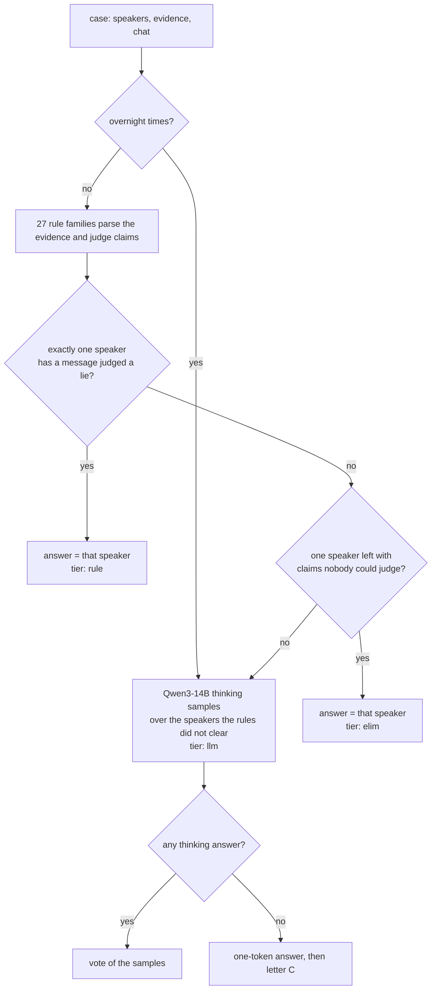

<div align="center">

# The Liar's Chatroom

**A rule solver that answers what it can prove, and Qwen3-14B in thinking mode for the rest.**<br>
Pure-Python rules, then an open-weight judge served with vLLM on two T4 cards, combined by one small vote.

[](#reproduce)
[](#model-used)
[](#rules-compliance)
<br>
[](#scorecard)
[](#how-we-tested)
[](#how-we-tested)

</div>

Team Claude Laggye's entry for the Kaggle competition The Liar's Chatroom (Synergy '26, IIIT Bangalore). This file is the methodology document for code verification. It says what each step does, which model and revision it uses, and which commands rebuild the uploaded file. Every number below comes from a command or file named next to it. The code we submit for checking is in [`submission/`](submission/README.md).

## Contents

- [The task](#the-task)
- [Scorecard](#scorecard)
- [How it works](#how-it-works)
- [Rules compliance](#rules-compliance)
- [Model used](#model-used)
- [Reproduce](#reproduce)
- [How we tested](#how-we-tested)
- [Results](#results)
- [What we tried and why it lost](#what-we-tried-and-why-it-lost)
- [Limitations](#limitations)
- [Repository layout](#repository-layout)
- [Licences, credits and citations](#licences-credits-and-citations)
- [Team](#team)

## The task

Each case is a short group chat between four speakers, A to D, plus a paragraph of verified evidence. Exactly one speaker sent a message that cannot be true together with the evidence. The solution must name that speaker. The metric is accuracy. `train.csv` has 2,500 labelled cases, `test.csv` has 3,500 unlabelled cases, and the public leaderboard scores about 900 of them (its scores move in steps of 1/900). The other test cases form the private slice.

The official rules, in brief:

- Only the evidence and the speaker table are true. A claim contradicts the evidence only if both cannot be true at once, judged by literal meaning, logic, and clock and calendar arithmetic. Unverified, suspicious or unlikely is not a contradiction.
- A person or object cannot be in two places at once when the evidence says the places are separate. Records and lists are complete only if the evidence says so. "Between 8:00 AM and 9:00 AM" includes both ends, and "after noon" excludes noon.
- Questions and opinions are never the answer. Tone, length and position do not mark the liar.
- The answer is the sender of the contradicting message, even when that message is about someone else.
- Test contains scenario families that train does not. The sponsor re-runs the frozen code of top teams on hidden cases, including families in neither file, offline on two T4 cards within 90 minutes for about 450 cases.
- No closed or hosted model APIs. Open-weight models are allowed if free for everyone, and every pretrained model must be named. The final code check limit is 15B total parameters. No hand labelling of test, and no designing rules by reading `test.csv`.

## Scorecard

Public leaderboard:

| File | What it contains | md5 | Public leaderboard |
|---|---|---|---|
| `s1_rules_only.csv` | Rule solver alone, letter C for every case the rules do not answer. A check of rule precision on test. | `96e2b8fd4448dde7caa94a58207d4178` | 0.93333 |
| `s6` | Rule solver, then Qwen3-14B-AWQ thinking on the 1,064 test cases the rules leave open, from the code in `submission/` before version 2. | `86ef374890c2aa1ab4be4340ab9bceb3` | pending upload |
| version 2 | The same from the code now in `submission/` (Kaggle kernel `predict-full-v2-nirbhay`). It replaces `s6` once its file is checked. | running | |

`s6` is rebuilt byte for byte from frozen model answers (see [Reproduce](#reproduce)).

Numbers for the final pipeline:

| Measure | Value | Source |
|---|---|---|
| Rule solver on train, cases answered | 2,257 of 2,500 (90.3%) | `python -m lc.rules.run` |
| Rule solver on train, precision on answered cases | 100.00% (2,257 of 2,257) | same |
| Liars wrongly judged consistent by the rules | 0 | same |
| New-family accuracy, `validation/newfam` (300 cases) | 0.957 (287 of 300) with version 2; 0.957 and 0.953 in two runs before it | [`submission/README.md`](submission/README.md), [`docs/BAKEOFF.md`](docs/BAKEOFF.md) |
| New-family accuracy, `validation/set2` (168 cases) | 0.946 (159 of 168) with version 2, against 0.911 before it (11 cases better, 5 worse) and 0.857 with a 4,096-token first sample | same |
| Kaggle check, 450 hard test cases, two T4 cards | 75.0 min including model load, limit 90; every case got a thinking answer (code before version 2) | `submission/README.md` |
| `s6`, full `test.csv` | 1,064 of 1,064 open cases got a thinking answer, 101 stopped at the cap and were forced, 194 extra samples | `results/frozen/s6/REBUILD.md` |

## How it works



### The rule solver

`lc/rules/core.py` defines a `Family` interface. A family recognises one kind of evidence, such as "nobody entered the vault between 9:00 AM and 11:00 AM" or "a tank holds 400 litres and is drained at a steady rate". It has two methods. `parse(ctx)` returns the facts if its evidence is in the case, and tells the solver which evidence sentences it understood. `judge(ctx, facts, msg)` returns a verdict of `lie` or `ok` for a message it fully understands, and nothing otherwise. A `lie` verdict is allowed only when the claim cannot be true together with the evidence. A case is answered when exactly one speaker has a message judged a lie.

There are 27 families in four modules: `fam_access.py` (9 families: windows, supplies, door codes, lists, badges, logs, arrivals, presence, bookings), `fam_calendar.py` (6: opening hours, closed days, rotas, sessions, ages, owners), `fam_movement.py` (8: routes, vehicles away, travel between places, rooms, objects, seals, hand-overs, counts) and `fam_quantity.py` (4: container levels, ticket sales, cut pieces, attendance lists). Shared parsing for clock times, dates, durations and sentences is in `lc/rules/text.py`.

The design puts precision before coverage:

- **Whole-sentence matching.** An evidence pattern must match a complete sentence, every clause. A sentence with a clause the family does not model (an exception, a second schedule, a condition) is left unread.
- **Abstain near unread evidence.** When an unread sentence names the same person, place, object or duty as a parsed fact, the family drops that fact and says nothing, because the unread sentence might change what the fact means.
- **Plain claims only.** Questions, hedged or negated sentences, reported speech and claims at the exact edge of a window are not judged. They stay with the model.
- **Exact arithmetic.** Quantities use Python `fractions.Fraction`, never floats. Times are whole minutes in one day.
- **The overnight guard.** `overnight()` in `core.py` makes the rules step aside for any case that mentions midnight or a clock time before 5:00 AM, because the families compare minutes within one day.
- **Fillers.** `is_filler()` treats a question, or a sentence with no digit that reads as an opinion, as no claim to judge. Only questions leave the vote, though: an opinion pattern can match a real claim ("I want to be clear: Priya never entered the lab").

An exception inside a family never stops a case. It is recorded and the family is skipped. On train there are none. On our 300 synthetic cases from 17 new families the rules answer none and misfire on none.

### The model judge

`submission/judge.py` serves Qwen3-14B-AWQ with vLLM (tensor parallel over both T4 cards, float16) on the cases the rules leave open. The prompt, built by `lc/llm/prompt.py`, holds the official rules in a short list, the scenario, the speaker table, the evidence, the numbered chat, and the instruction to check every claim against the evidence and end with `ANSWER: <letter>`. Sampling is thinking mode, temperature 0.6, top-p 0.95, top-k 20.

- **First sample.** Each case gets one sample, shortest prompt first, capped at 3,072 tokens. The cap is fixed. It does not shrink when time runs short, and there is no cap on the tail of the queue.
- **No continuations.** A sample that hits the cap is forced to an answer: `ANSWER:` is appended and one token is read. Spare time goes to extra samples (different seeds) for the least certain cases, up to 5 samples a case, and none once two clean samples agree.
- **Time.** `predict.py` allots 80 minutes to a file of 450 to 1,500 cases, the same time per case for smaller files and 80 minutes per 450 judged cases for larger ones. In the last 5 minutes no new work starts, and any case without a finished sample gets a one-token answer without thinking. Extra samples already running go on when every case has its first sample.
- **Failure handling.** The predictions file is complete from the first second and is rewritten every 30 s. A model process that crashes or stalls is restarted with safer settings, ending on one card. Without a GPU the rule answers and fallbacks stand.

### The vote

`lc/combine.py` decides each case in this order:

1. **rule.** Exactly one speaker has a message judged a lie, so that speaker is the answer.
2. **elim.** No rule fired, but every claim of three speakers was judged consistent and the fourth has claims nobody could judge. One liar exists, so it is the fourth. On train this tier never fires. On test it fires for 8 cases.
3. **llm.** The samples vote over the speakers the rules did not clear. A speaker is cleared when all of their messages other than questions were judged consistent. A forced answer counts at half weight.
4. **fallback.** A case the model never reached gets a one-token answer without thinking, and failing that the letter C, the most common train label.

`predict.py` keeps a rule or elim answer, and the cleared speakers, only when the rules read every evidence sentence. A sentence no family reads can change what the rest means, so such a case goes to the model with no speaker cleared. On train this sends 36 of the 2,257 rule answers to the model.

### Robustness

Fixes from a robustness review in version 2, one line each:

- `setup.sh` runs under `sh` as well as `bash`: no `pipefail`, which Ubuntu's `sh` (dash) rejects.
- `setup.sh` installs `uv` with a plain `pip install` first, since pip refuses `--user` inside a virtualenv.
- `setup.sh` keeps a Python that `uv` downloads in `.python` beside the code, so `.venv/bin/python` does not point into a home folder; `predict.py` logs an error when it does not resolve.
- `setup.sh` gives the package install and the model download two more tries, 30 s apart.
- `setup.sh` ends by running a tensor on a card, so a driver that cannot run CUDA 12.9 fails setup and not the run.
- The zip marks its files as made on Unix, so `unzip` keeps `setup.sh` and `predict.py` executable.
- A model process that has not started after 10 minutes is restarted on one card at once, instead of hanging 20 minutes on each of three attempts.
- The third and fourth attempts leave more card memory free, and the one-card attempt uses a 5,120-token context.
- Files of 450 to 1,500 cases get 80 minutes; before, 601 cases got 106.8 minutes against a 90-minute limit.
- An error in the polling loop keeps the model answers already read, and a killed process that does not exit is left after 60 s.
- Chat and speaker lines in other forms are read instead of getting the letter C.
- A rule answer counts only when the rules read every evidence sentence, and only questions leave a speaker out of the vote.
- In Docker, run with `--ipc=host`: the two-card engine passes tensors through shared memory.

## Rules compliance

Competition rule numbers refer to section 10 of the Rules tab.

| Rule | What this entry does |
|---|---|
| 10a. No closed or hosted model APIs at any step | No network call to a model service exists in the code. The model runs locally from downloaded weights, through vLLM. `predict.py` runs offline. |
| 10b. Open-weight model within the size limit, licence allows use, named | One model, Qwen3-14B-AWQ, Apache-2.0, 14.8B total parameters on the official page (limit 15B). Named with repository and revision in [Model used](#model-used). |
| 10c. Public external data and compliant synthetic data only | No external data. Nothing is trained or fine-tuned. The model is used as released. The labelled validation sets in `validation/` are used only to choose the model and the caps. |
| 10d. No hand labelling of test | No test label was typed, read or chosen by a person. Test labels come only from the rule solver and the model. |
| 10e. No test-specific design | Rule families were written from train cases and scored on train only (`lc/rules/run.py` refuses any other split). Test inputs go through the same code as train. No test row was read or printed, and no logic is keyed to a test id. |
| 10f. Reproducible from code | The rules, prompt, judge, vote and submission check are in this repository, with the pinned model revision and package versions. See [Reproduce](#reproduce). |
| 10g. Pseudo-labelling only if automatic | None is used. Model answers are never fed back into the rules or the prompt. |

## Model used

| Model | Revision | Licence | Size | Used for |
|---|---|---|---|---|
| [`Qwen/Qwen3-14B-AWQ`](https://huggingface.co/Qwen/Qwen3-14B-AWQ), the Qwen team's 4-bit quantisation of Qwen3-14B | `31c69efc29464b6bb0aee1398b5a7b50a99340c3` | Apache-2.0 | 9.3 GB on disk | the judge, on every case the rules leave open |

`submission/setup.sh` downloads it to `models/judge`. Libraries: vLLM 0.32.0, PyTorch 2.13.0 for CUDA 12.9, Transformers 5.19.0, pinned in `submission/requirements.txt`. The candidates we dropped are listed with their revisions in `docs/models.md`.

## Reproduce

### The final code

```
bash setup.sh                                                   # once, with internet
python predict.py --input hidden.csv --output predictions.csv   # offline
```

`python submission/make_zip.py` puts `lc/` beside these files in a zip; run both commands from the unpacked zip. `submission/README.md` has the settings, the time budget and the Kaggle checks.

### The rule solver on train

About 10 s on a laptop CPU. Set `LC_DATA_DIR` to the folder holding `train.csv`, `test.csv` and `sample_submission.csv`. The data files are not committed.

```
LC_DATA_DIR=<data> python -m lc.rules.run
```

It prints cases answered, precision, wrongly cleared liars and per-family counts. `lc.rules.run` is train-only by design.

### Rebuild the final file

`results/frozen/s6/` holds the 1,064 answers of the full run. This rebuilds the upload from them. The md5 of the output is `86ef374890c2aa1ab4be4340ab9bceb3`:

```
python -c "import sys; sys.path.insert(0, 'submission'); import predict as p; \
ids, fixed, cases, cands = p.read_cases('<folder with the competition CSVs>/test.csv'); recs = {}; \
p.merge('results/frozen/s6/test_qwen3-14b-awq_predict_3072.jsonl', 0, recs); \
print(p.write_predictions('s6_rebuild.csv', ids, fixed, cands, recs))"
```

Rerunning the judge can change a few answers, because batched GPU inference is not bit-exact between runs. Rebuilding from the frozen answers is exact.

### Frozen runs

Each folder in `results/frozen/` has the model answers and a `REBUILD.md` with the command and the md5 to expect.

| Folder | What it is |
|---|---|
| [`s2`](results/frozen/s2/REBUILD.md) | First model upload (public 1.00000): rules plus Qwen3.5-4B and Qwen3-8B votes |
| [`s3`](results/frozen/s3/REBUILD.md) | Weighted vote of 4B, 8B, 14B and 32B files, from the first plan |
| [`s4`](results/frozen/s4/REBUILD.md) | Final code with the old tail cap. Kept for the record |
| [`s5`](results/frozen/s5/REBUILD.md) | Final code with a 4,096-token first sample and continuations. Fallback |
| [`s6`](results/frozen/s6/REBUILD.md) | Final code before version 2, 3,072-token first sample, no continuations. The final file until version 2's run is checked |

### Kaggle kernels

The kernels in [`kaggle/`](kaggle/) run on two T4 cards. `kaggle/build.py` embeds the committed `lc` files into one `run.py` per kernel and refuses to build if they have uncommitted changes.

| Folder | What it ran |
|---|---|
| `v2-set2`, `v2-newfam`, `v2-ending`, `v2-moved` | version 2's paired checks on set2 and newfam, the forced-ending test and the moved rule answers (`kaggle/build_v2.py`) |
| `predict-full-v2`, `predict-test-v2` (and `-nirbhay` copies) | version 2's full `test.csv` run and its 450-case check; steps in `kaggle/V2_FINAL.md` |
| `predict-full-final` | `predict.py` on the full `test.csv` (produced `s6`) |
| `predict-test-final` | `predict.py` on 450 hard test cases (the 75.0-minute check) |
| `predict-full`, `predict-full-nocap`, `predict-test`, `predict-test-nocap` | the same with earlier settings (`s4`, `s5`) |
| `bake-*` | one folder per candidate model on the 300 new-family cases |
| `judge14b-*`, `judge32b-*`, `judgeqwq-*` | the first test-set judge runs (`s3`) |
| `bench-t4`, `build_*.py`, `kjudge.py`, `launcher.py` | speed benchmark and notebook builders |

## How we tested

- **Rule solver on train.** `python -m lc.rules.run` scores the rules on all 2,500 train cases. It reports cases answered (2,257), precision on those (100%), how often a family judged an innocent speaker a liar (0), and the number of cases where every claim of the true liar was judged consistent (0). That last number must be zero, since a wrongly cleared liar would be removed from the vote and could never be found. Every rule change was held to these numbers.
- **New-family sets.** The hidden cases come from families in neither train nor test, so we wrote labelled cases for that. `validation/newfam` has 300 cases from 17 families. `validation/set2` has 153 cases from nine more families, checked claim by claim against every world the evidence allows, plus 15 cases from a teammate (`validation/open_model_cases.csv`). The rules answer none of the 300 and misfire on none (`validation/newfam/REPORT.md`).
- **Bake-off.** Each candidate ran through the full `predict.py` on Kaggle's two T4 cards at the time per case of the hidden run. Accuracy counts every case, including those the model did not reach in time. Tables: `docs/BAKEOFF.md`.
- **Paired cap test.** On the 168 cases of `validation/set2` we compared the 3,072-token first sample with 4,096 on the same cases: 10 cases better, 1 worse, two-sided sign test p = 0.012.
- **Paired version 2 test.** Version 2 against the code before it, same cases and time per case: `validation/set2` 0.946 against 0.911 (11 cases better, 5 worse, p = 0.21; 167 of 168 cases reached against 152), `validation/newfam` 0.957 against 0.957 (4 better, 4 worse). The ship rule was set before the runs: at least 3 cases better on set2 with at most 10 cases never reached, and at most 1 case worse on newfam.
- **Public leaderboard.** Used as a check of the finished pipeline, never to tune.

## Results

| Item | Value | Where it comes from |
|---|---|---|
| Public leaderboard, rules only (`s1`) | 0.93333 | Kaggle |
| Public leaderboard, best earlier uploads (`s2`, `s3`) | 1.00000 | Kaggle |
| Public leaderboard, final file (`s6`) | pending upload | Kaggle |
| Rule solver on test, cases answered | 2,436 of 3,500 (69.6%), 8 of them by elimination | `results/frozen/s6/REBUILD.md` |
| Test cases the model judged | 1,064 | same |
| `s6` first samples | 1,064 of 1,064 got a thinking answer; 101 stopped at 3,072 tokens and were forced | same |
| `s6` extra samples | 194 | same |
| `s6` runtime on Kaggle | 184.2 min of a 189.2 min budget, exit 0 | same |
| New-family accuracy, 300 cases | 0.957 (version 2); 0.957 and 0.953 before it | `submission/README.md`, `docs/BAKEOFF.md` |
| New-family accuracy, 168 cases | 0.946 (159 of 168, version 2); 0.911 before it, 0.857 with the 4,096 cap | same |
| Kaggle check, 450 hard cases | 75.0 min including model load; limit 90 | `submission/README.md` |
| Kit selftest, 200 cases | OK, accuracy 1.000, 5.4 min | same |

The first upload scored 0.93333 with C filled in for every unanswered case. That means the rules answered about 91% of the public slice. They answer 69.6% of all test cases, so coverage on the rest is lower, and the public score flatters the private slice.

## What we tried and why it lost

- **Votes of several models** (Qwen3.5-4B, Qwen3-8B, Qwen3-32B, QwQ-32B, weighted). This was our first plan (`s3`). On a T4 a model's speed in tokens per second hardly depends on its size, so the number of tokens a model writes per case decides how many cases it finishes. The 14B writes about half as many as the 8B.
- **Smaller models on new families.** On the 300 cases the 8B scored 0.893 at best and 0.643 with a long cap, and DeepSeek-R1-0528-Qwen3-8B reached 13 cases and scored 0.313. Qwen3-14B-AWQ scored 0.957.
- **Long continuations.** Continuing capped samples to 8,192 tokens gave a net 3 more right answers on 49 hard cases (p = 0.51) and cost 2,595 s. Extra samples in the spare time did better.
- **A tail cap and a 4,096-token first sample.** The tail cap cut later cases short, and 4,096 left fewer cases a thinking answer in time. 3,072 raised the second set from 0.857 to 0.911.
- **A forced answer that restates the rule.** Ending a capped sample with "Time is up. Only one message cannot be true..." before `ANSWER:` changed none of 62 forced answers (37 right either way).

## Limitations

- **New families.** The rules are written from train and mostly abstain on a family they have not seen. The model decides, and our estimate of its accuracy is 0.95 to 0.96 on cases we wrote ourselves, which may differ from the hidden cases.
- **Rule coverage is not accuracy on test.** The rules score 100% on train because they were built against it. Their precision on test is checked only through the public leaderboard.
- **Time.** On two T4 cards a case whose first sample has not ended by the deadline gets a one-token answer, which is right far less often. On one T4 the model reaches about a third as many cases a minute, so fewer get a thinking answer.
- **Not bit-exact.** vLLM batching can change near-ties between two runs of the judge. The vote is deterministic, the judge is not.
- **Unseen wordings.** No test row was read, so a wording that appears only in test is handled only if a family's whole-sentence patterns happen to match it.

## Repository layout

```
submission/          the code submission: predict.py, judge.py, setup.sh, requirements.txt, team_info.json, README.md
lc/
  data.py            read the CSVs into Case objects (LC_DATA_DIR)
  rules/
    core.py          Family interface, solver, overnight guard
    text.py          clock times, dates, durations, sentence splitting, fillers
    fam_access.py    9 families: who could enter, use or be somewhere, and when
    fam_calendar.py  6 families: opening hours, closed days, rotas, sessions, ages, owners
    fam_movement.py  8 families: routes, travel, rooms, objects, seals, hand-overs, counts
    fam_quantity.py  4 families: container levels, tickets, cut pieces, attendance
    run.py           score the rules on train
  llm/
    prompt.py        the judge prompt
    judge_vllm.py    batched vLLM runner used in the bake-offs and first runs
    eval.py          score a judge's output on train
    dev_ids.py       draw dev200
  combine.py         rule, elimination, vote, predictions file
  submit.py          check a submission file and log its md5
validation/          newfam (300 cases), set2 (153 cases), open_model_cases.csv (15 cases)
results/frozen/      s2 to s6: model answers and REBUILD.md for each upload
kaggle/              Kaggle kernels and their builders
docs/                BAKEOFF.md, models.md, ids/ (test_llm_order.txt, train_hard.txt)
configs/dev200.txt   200 train ids drawn with a fixed seed
scripts/server/      setup_env.sh, get_models.sh, smoke_test.sh and .py for the GPU server
```

Where our code is:

| Question | File |
|---|---|
| What does a rule family look like? | `lc/rules/core.py` |
| Why does the rule solver ever stay silent? | `lc/rules/core.py` (`overnight`, `Ctx.consume`) and the module docstrings of the four `fam_*.py` files |
| What prompt does the model get? | `lc/llm/prompt.py` |
| How are samples scheduled and forced? | `submission/judge.py` |
| How are the votes combined? | `lc/combine.py` (`decide`, `vote`) |
| How is a file checked before upload? | `lc/submit.py` |

## Licences, credits and citations

| Component | Use | Licence |
|---|---|---|
| [Qwen3-14B-AWQ](https://huggingface.co/Qwen/Qwen3-14B-AWQ) by the Qwen team, Alibaba Cloud | the judge | Apache-2.0 |
| [vLLM](https://github.com/vllm-project/vllm) 0.32.0 | model serving | Apache-2.0 |
| [PyTorch](https://pytorch.org) 2.13.0 | tensor library under vLLM | BSD-3-Clause |
| [Transformers](https://github.com/huggingface/transformers) 5.19.0 | tokenizer and chat template | Apache-2.0 |
| [huggingface_hub](https://github.com/huggingface/huggingface_hub) 2.4.0 | weight download | Apache-2.0 |

Models tried and dropped (Qwen3-8B, Qwen3-32B, QwQ-32B, Qwen3.5-4B, DeepSeek-R1-0528-Qwen3-8B) are listed in `docs/models.md` and `docs/BAKEOFF.md`. The rule solver and vote use only the Python standard library.

- Qwen Team, Qwen3 Technical Report, 2025. https://arxiv.org/abs/2505.09388
- Kwon et al., Efficient Memory Management for Large Language Model Serving with PagedAttention, SOSP 2023. https://arxiv.org/abs/2309.06180
- Lin et al., AWQ: Activation-aware Weight Quantization for LLM Compression and Acceleration, MLSys 2024. https://arxiv.org/abs/2306.00978

## Team

Team Claude Laggye, Synergy '26, IIIT Bangalore.

- Kanav Bhardwaj ([@Paradox-73](https://github.com/Paradox-73))
- Nirbhay Sharma ([@NirbhaySharma504](https://github.com/NirbhaySharma504))
- Bhavya Jain ([@Bhavzzzzzz](https://github.com/Bhavzzzzzz))
- Aaryan Antala ([@AaryanAntala](https://github.com/AaryanAntala))

Repository: [github.com/Paradox-73/Liars_Chatroom](https://github.com/Paradox-73/Liars_Chatroom), private until the organisers ask for it.
